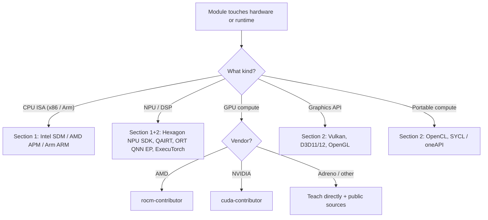

_SPDX-License-Identifier: MIT_
# Hardware + Runtimes — routing and public sources for CPU / GPU / NPU

Load this file only when a module touches processors (x86, Arm, GPU, NPU) or a
compute runtime/API. Teach directly with the sources below; delegate to a
specialist skill only where the table says so. All links are public. Re-verify
version- or SKU-specific claims at the linked page (they drift).

## 1. Processor class -> where to teach from

| Module topic | Teach from (public) | Delegate depth to |
|--------------|---------------------|-------------------|
| x86 / x86-64 ISA, microarchitecture | [Intel SDM](https://www.intel.com/content/www/us/en/developer/articles/technical/intel-sdm.html), [AMD64 Architecture Programmer's Manual](https://docs.amd.com/v/u/en-US/24593_3.43) | `principal-uefi-engineer` for boot/firmware; teach directly otherwise |
| Arm ISA (AArch64), memory model, exceptions | [Arm Architecture Reference Manual (A-profile)](https://developer.arm.com/documentation/ddi0487/latest), [Arm architectures hub](https://developer.arm.com/architectures), [Armv8-A Programmer's Guide](https://developer.arm.com/documentation/den0024/latest) | `principal-uefi-engineer` for Arm boot/firmware |
| Arm-based Windows / Snapdragon CPU | [Qualcomm developer portal](https://www.qualcomm.com/developer), [Qualcomm docs](https://docs.qualcomm.com/) | teach directly |
| Qualcomm Hexagon NPU / DSP | [Hexagon NPU SDK](https://www.qualcomm.com/developer/software/hexagon-npu-sdk) | teach directly (no specialist skill) |
| Qualcomm Adreno GPU | [Qualcomm developer portal](https://www.qualcomm.com/developer), [Snapdragon Profiler](https://www.qualcomm.com/developer/software/snapdragon-profiler) | teach directly; graphics API depth per section 2 |
| AMD GPU compute | [ROCm docs](https://rocm.docs.amd.com/) | `rocm-contributor` |
| NVIDIA GPU compute | [CUDA docs](https://docs.nvidia.com/cuda/) | `cuda-contributor` |
| Multi-node / fabric / scheduler | [Top500](https://top500.org) | `cluster-ops` |

Pick the teaching altitude by the learner's level: ELI5 first (CPU = few very
smart workers, GPU = thousands of simple workers, NPU = a fixed-function
assembly line for tensor math), then the rigorous model (pipelines, memory
hierarchy, quantized datatypes, scheduling). Flag where each analogy breaks.

## 2. Runtime / API -> primary source

Compare runtimes on the same axes every time: **portability, hardware reach,
maturity, tooling, and what you give up**. Never rank them without stating the
workload.

| Runtime / API | Use it to teach | Primary source (public) |
|---------------|-----------------|-------------------------|
| **Qualcomm AI Runtime (QAIRT)** incl. AI Engine Direct (QNN) | on-device inference on Snapdragon CPU/GPU/NPU (Hexagon) | [AI Engine Direct SDK](https://www.qualcomm.com/developer/software/qualcomm-ai-engine-direct-sdk), [Qualcomm docs](https://docs.qualcomm.com/) |
| **Qualcomm AI Hub** | compile, profile, and deploy models to Qualcomm devices | [AI Hub](https://aihub.qualcomm.com/), [docs](https://app.aihub.qualcomm.com/docs), [ai-hub-models](https://github.com/qualcomm/ai-hub-models) |
| **ONNX Runtime + QNN EP** | one model format, Qualcomm NPU through an execution provider | [QNN Execution Provider](https://onnxruntime.ai/docs/execution-providers/QNN-ExecutionProvider.html) |
| **ExecuTorch (Qualcomm backend)** | PyTorch-native edge deployment to Qualcomm NPU | [ExecuTorch Qualcomm backend](https://pytorch.org/executorch/stable/backends-qualcomm.html) |
| **Windows ML / NPU devices** | Windows-level NPU and AI APIs | [Windows ML](https://learn.microsoft.com/en-us/windows/ai/new-windows-ml/overview), [NPU devices](https://learn.microsoft.com/en-us/windows/ai/npu-devices/), [DirectML](https://learn.microsoft.com/en-us/windows/ai/directml/dml) |
| **oneAPI / SYCL** (Intel) | single-source C++ across CPU/GPU/accelerators | [oneAPI spec](https://oneapi-spec.uxlfoundation.org/), [oneAPI overview](https://www.intel.com/content/www/us/en/developer/tools/oneapi/overview.html), [SYCL](https://www.khronos.org/sycl/) |
| **Vulkan** | explicit low-overhead graphics + compute | [Vulkan registry](https://registry.khronos.org/vulkan/), [Vulkan docs](https://docs.vulkan.org/) |
| **OpenCL** | portable heterogeneous compute kernels | [OpenCL registry](https://registry.khronos.org/OpenCL/) |
| **OpenGL / OpenGL ES** | legacy and mobile graphics pipeline | [OpenGL registry](https://registry.khronos.org/OpenGL/), [OpenGL refpages](https://registry.khronos.org/OpenGL-Refpages/), [OpenGL ES](https://www.khronos.org/opengles/) |
| **Direct3D 11** | higher-level Windows graphics | [D3D11 docs](https://learn.microsoft.com/en-us/windows/win32/direct3d11/atoc-dx-graphics-direct3d-11) |
| **Direct3D 12** | explicit Windows graphics + compute | [D3D12 guide](https://learn.microsoft.com/en-us/windows/win32/direct3d12/directx-12-programming-guide), [DirectX specs](https://microsoft.github.io/DirectX-Specs/) |
| **HIP / ROCm** | AMD GPU compute | [ROCm docs](https://rocm.docs.amd.com/) -> `rocm-contributor` |
| **CUDA** | NVIDIA GPU compute | [CUDA docs](https://docs.nvidia.com/cuda/) -> `cuda-contributor` |

## 3. Comparison axes to teach (fill per module)

- **Abstraction level:** explicit (Vulkan, D3D12) vs. driver-managed (OpenGL, D3D11).
- **Portability vs. peak performance:** portable (OpenCL, SYCL, ONNX Runtime) vs.
  vendor-tuned (CUDA, QAIRT/QNN, ROCm).
- **Precision/quantization support:** NPUs typically favor low-precision integer
  or reduced-float paths; state the supported datatypes from the vendor doc.
- **Graph vs. kernel model:** whole-graph compile (QNN, ExecuTorch) vs.
  hand-written kernels (CUDA, OpenCL, compute shaders).
- **Tooling:** profilers, debuggers, and conversion tools are often the real
  deciding factor.

State the tradeoff and mitigation for each runtime taught, per the module
template's challenges section.

## 4. Routing rules

1. Teach the concept (memory hierarchy, parallelism, quantization) directly first.
2. Open this file's section 2 row for the **one** runtime the module needs; do not
   load every source.
3. Delegate to `rocm-contributor` / `cuda-contributor` / `cluster-ops` /
   `principal-uefi-engineer` only at the gate where the module needs repo-level or
   build-level depth.
4. For Qualcomm topics, prefer the public pages above. If an internal-only
   documentation tool is available in the session, it may inform your own
   understanding, but never cite or reproduce internal content in learner-facing
   output; link the public equivalent or say none exists.
5. If a needed source is not listed here, say so and point the learner to the
   vendor's official docs rather than guessing a URL ([citations.md](citations.md)).

